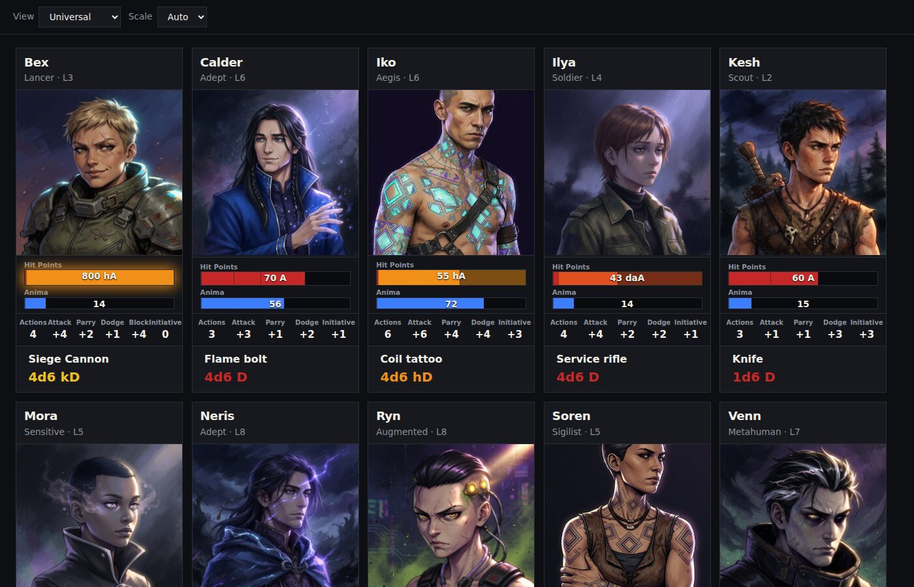

# Lex

Lex is a playable universal RPG system (characters, combat, armor, damage) which can integrate with any other system, allowing conversion to/from any ingested system.

The rules and app design are in [docs/universal-system.md](docs/universal-system.md); the implementation plan is [docs/plan.md](docs/plan.md). The glossary is [docs/glossary.md](docs/glossary.md).


## Run

```bash
uv sync --group dev
uv run lex import                 # data/packs/* into lex.db (sqlite)
uv run lex user add tim --gm      # a GM login; players can sign up in the app
uv run lex user own tim pc-ilya   # give a character to a login
uv run lex serve
```

Open http://127.0.0.1:8000 — roster of sample characters on the **Universal** adapter. `uv run lex export universal out/` writes a pack back out.



```bash
uv run lex test
```

## Packs vs ingest

- `data/packs/` — catalog the engine loads. `universal/` is the native pack; `u-simplified/` is a sheet adapter. Other packs live here too.
- `data/ingest/` — local notes and book links (git tracks only `data/ingest/README.md`)

Do not commit material you do not have the right to distribute. Details: `docs/ingest.md`.

## Contributions

Pull requests must not add text, art, names, or stats copied from a game you do not own the rights to ship. Mapping notes for other publishers’ games stay in local `data/ingest/` (gitignored except `data/ingest/README.md`). The public packs in this repo are original.

## License

Apache 2.0 for the software. Sample characters and the universal adapter are original to this repo.
